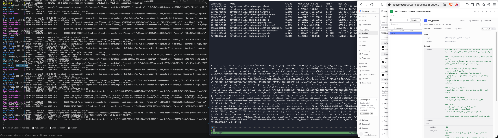
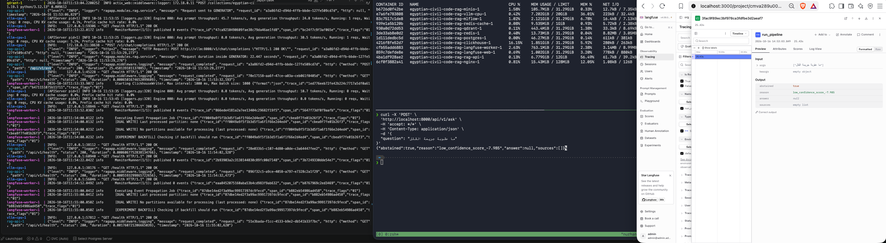
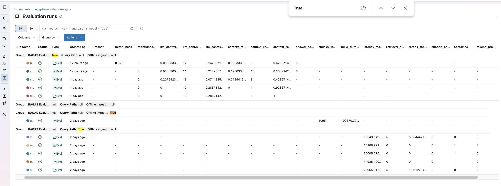
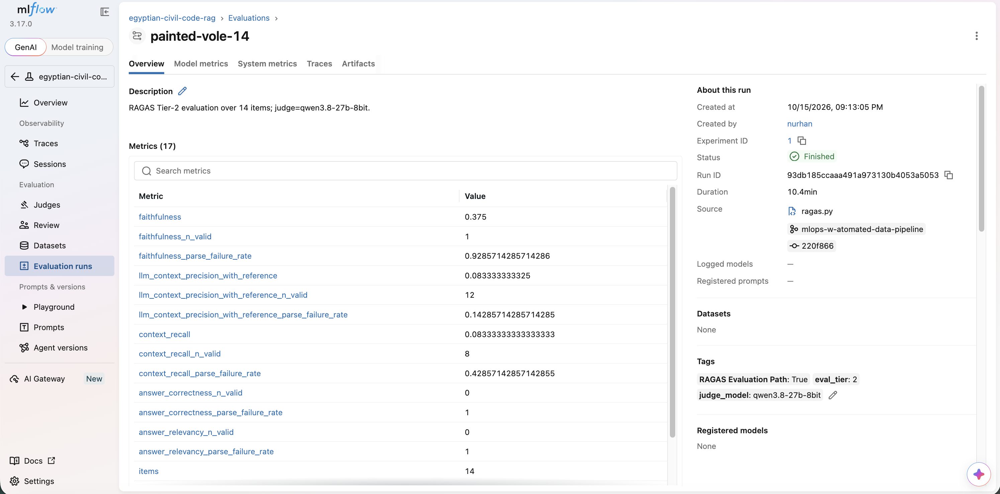
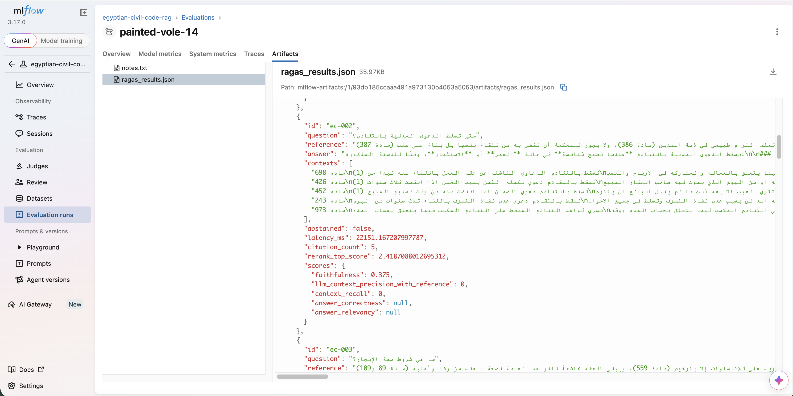

# Reports

- [Reports](#reports)
  - [Langfuse Traces](#langfuse-traces)
  - [MLFlow Runs](#mlflow-runs)
  - [RAGAS Evaluations](#ragas-evaluations)
  - [Lucast Testing](#lucast-testing)

## Langfuse Traces

* A langfuse trace for an answered question, end-to-end on docker compose CPU profile.

    

* A langfuse trace for an abstained question, end-to-end on docker compose CPU profile.

    

## MLFlow Runs

* MLflow runs grouped by **Query Path**, **Offline ingestion Path** & **RAGAS Evaluation Path** runs.

    

* More MLFlow runs for different runs [Here](../assets/)

## RAGAS Evaluations
* Ragas runs tracked in MLFlow with aggregated metrics.
    

* RAGAS run artifacts logged for every single query with its details and evaluation metrics. 
    

## Lucast Testing
* Locust tiny load testing [Here](./smoke.html)